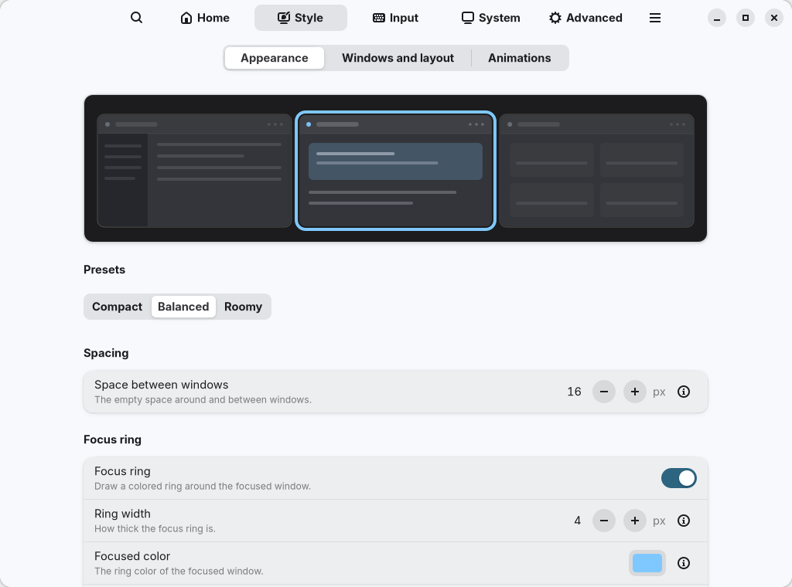
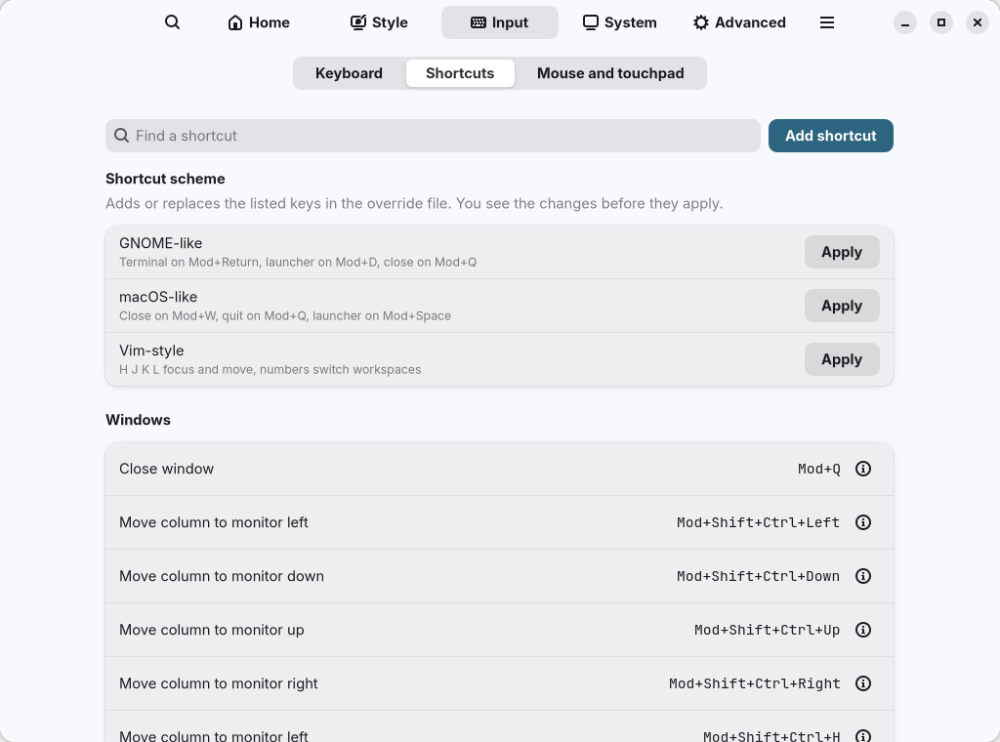
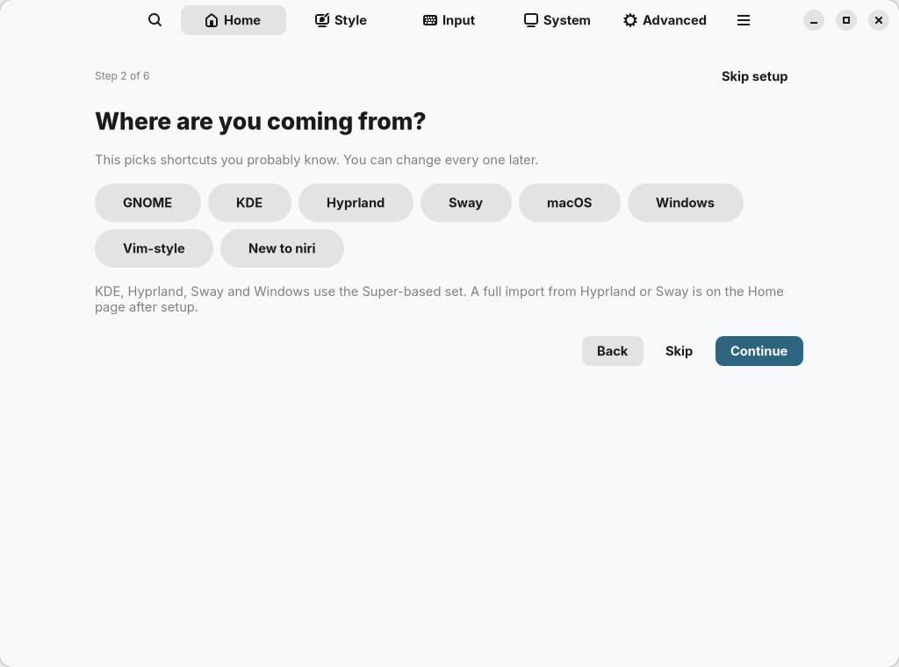

<p align="center">
  
</p>

<h1 align="center">niri settings</h1>

<p align="center">
  A safe graphical settings app for the <a href="https://github.com/niri-wm/niri">niri</a> compositor.
</p>

<p align="center">
  <a href="https://github.com/pantarune/niri-settings/actions/workflows/ci.yml"></a>
  <a href="LICENSE"></a>
</p>

<p align="center">
  
</p>

Change niri from one window instead of editing KDL by hand. Every change is
validated with `niri validate`, can be undone, and leaves your comments and
formatting alone.

The app checks each file immediately before writing, but that check is not a
lock. A program writing in that same instant can still be overwritten. Every
change has Undo, and an interrupted multi-file write is rolled back.

## Install

### Nix

Run it:

```sh
nix run github:pantarune/niri-settings#niri-settings-app
```

Install it:

```sh
nix profile install github:pantarune/niri-settings#niri-settings-app
```

NixOS or Home Manager:

```nix
environment.systemPackages = [
  inputs.niri-settings.packages.${pkgs.system}.niri-settings-app
];
```

### Build from source

```sh
nix develop
cargo run -p niri-settings-app
```

### Other distributions

Recipes for nixpkgs, the AUR and Fedora COPR are in
[`packaging/`](packaging/README.md). Until those packages are accepted, use the
flake or build from source.

The GUI binary is `niri-settings-app`. The `niri-settings` packages in Fedora
and openSUSE, and the AUR `niri-settings-git`, are a different Qt application.

The app needs niri 25.11 or later, because it uses the `include` config option.
`niri` must be on `PATH`, because every write is checked with `niri validate`.

## What it does

| Feature | What it does |
| --- | --- |
| Live changes | A slider or switch changes niri at once. There is no Save button. |
| Undo and history | Every change is one undo step. History keeps the last 200 versions. |
| Safe writes | Validates a scratch copy, checks the files on disk, records history, renames atomically, and rolls back a failed multi-file write. |
| Welcome | A first-run flow for shortcuts, look, motion and keyboard layout. Choices are written once at the end. |
| Visual options | Gaps, borders, shadows and animations have a live picture. |
| Managed files | Values from Noctalia, DMS, Stylix or Nix go to an override file. |
| Check my setup | Finds duplicate shortcuts, missing programs, bad includes and more. |
| Import | Reads Hyprland and Sway configs and shows a preview before it writes. |
| Shortcut editor | Records keys, finds conflicts, and applies GNOME, macOS or Vim schemes. |
| App rules | Adds and edits window rules in plain words. Pick a window to start. |
| Displays | Drag to arrange. Changes mode, scale, rotation, position and VRR with a 15-second revert. |
| Search | Finds every option by plain words or config name. |
| Nix users | Copies changed values as a `programs.niri.settings` block. |
| CLI | Reads, sets, checks and imports with `--json` for scripts. |
| D-Bus | `io.github.niri_settings.NiriSettings1` lets a desktop shell read and set options. |
| Schema | Reads 194 options from the niri 26.04 source. The 68 designed options have controls. You edit the other options on the Config file page. |
| Repair mode | Opens a small editor when the config has a syntax error. It saves only after niri accepts the text. |

## Shortcut editor

Record keys, find conflicts, or start from a familiar scheme.



## First run

A six-step setup picks shortcuts, look, motion and keyboard layout, then writes
once.



## Use

Start the app with no arguments. It opens `~/.config/niri/config.kdl`.

```sh
niri-settings-app
niri-settings-app --config ./test.kdl
niri-settings-app --page shortcuts
```

Press Control+F to search. Press Control+Z to undo.

## Command line

The `niri-settings-cli` command uses the same core as the app.

```sh
niri-settings-cli get layout.gaps
niri-settings-cli set layout.gaps 16
niri-settings-cli undo
niri-settings-cli history
niri-settings-cli check
niri-settings-cli import ~/.config/hypr/hyprland.conf --dry-run
niri-settings-cli why window
niri-settings-cli --recover
```

Every command accepts `--config PATH` and `--json`.

## D-Bus

The `niri-settings-daemon` command starts the service
`io.github.niri_settings.NiriSettings1` on the session bus. It uses the same
core as the app.

```sh
niri-settings-daemon
busctl --user call io.github.niri_settings.NiriSettings1 /io/github/niri_settings/NiriSettings1 \
  io.github.niri_settings.NiriSettings1 Get s layout.gaps
busctl --user call io.github.niri_settings.NiriSettings1 /io/github/niri_settings/NiriSettings1 \
  io.github.niri_settings.NiriSettings1 Set ss layout.gaps 16
busctl --user call io.github.niri_settings.NiriSettings1 /io/github/niri_settings/NiriSettings1 \
  io.github.niri_settings.NiriSettings1 Undo
```

Methods: `Get`, `Set`, `Undo`, `Redo`, `ListOptions`. The service emits a
`Changed` signal after each change.

## How a write works

The core follows these steps for every change.

1. Copy the config and all files that it includes to a scratch folder.
2. Apply the change to the scratch copy.
3. Run `niri validate` on a mirror of the scratch copy, with include paths
   rewritten.
4. Compare each real file with the text that was loaded. Stop on a conflict.
5. Record one history entry. If it cannot be saved, nothing is written.
6. Write a recovery journal with the before and after text of every file.
7. Write the changed files one at a time in dependency order: override files
   first, then included files, then the file that includes them; deletions
   last. Each write is an atomic rename.
8. Mark the journal committed, then remove it.
9. If a write fails, restore the files already written from their recorded
   old text, newest first. The history entry is discarded only when the
   rollback succeeded; after a failed rollback the journal stays for the
   next start.

A validation failure writes nothing. On the next start, an unfinished write
is replayed: a change that was not marked complete is rolled back, one that
was is finished. A file changed by another program while the journal waited
is reported and left untouched.

## Compatibility

Built and verified against niri 26.04. The config it writes needs niri 25.11 or
later, when `include` was added.

<details>
<summary>niri behaviors the app relies on</summary>

- niri merges an included file at the line of the `include`. If a value is
  set twice, niri uses the later value.
- Includes nest up to 10 levels.
- `include optional=true "file.kdl"` accepts a missing file.
- A duplicate section node in one file is an error. A second `binds` node in
  one file is also an error.
- A later bind with the same key replaces an earlier bind.
- `layout { border {} }` enables the border in the main file. In an included
  file it does nothing.
- `struts`, preset widths, pointing-device sections and animation subsections
  replace the whole section. They do not merge.
- Most flags accept `false` at the top level. Nested flags such as
  `natural-scroll` do not accept an argument.
- `niri msg --json outputs`, `windows` and `pick-window` work.
- `niri msg output NAME ...` changes a display for the session only.
- `niri msg action load-config-file` reloads the config.

</details>

## Compared with other apps

| App | Focus |
| --- | --- |
| niri settings (this app) | Safe writes, undo, history, checks, import, CLI, display drag and revert |
| [NiriMod](https://github.com/srinivasr/nirimod) | Drag-and-drop monitors, key heat map, spring curve editor, raw KDL editor |
| [niri-settings](https://github.com/stefonarch/niri-settings) | PyQt tabs, shortcut editor, window tools, config backups |

This app puts four features in one place: managed-file overrides, undo for
every change, setup checks with fixes, and a CLI with JSON output.

On the Displays page, you drag displays to arrange them. Edges snap. If you do
not press Keep within 15 seconds, the display change reverts.

## Status

Version 0.1.0. The core, app, CLI and D-Bus service work.

Current limits:

- The welcome flow shows five shortcuts but cannot print them or save them as a PNG.
- Only page titles and common controls have German, French and Turkish
  translations. Most option help is in English only.
- A human Orca pass is still pending. The app has an automated control-name
  audit and a written [Orca procedure](docs/accessibility.md).
- Shortcut recording reports taken keys. It does not stop niri from handling
  the key while you record.
- Copy as Nix writes a `programs.niri.settings` block with niri config names.
  niri-flake uses different names for some options, so you can need to edit
  the block.

## Schema generation

`data/schema.json` comes from the niri-config source. `data/schema.version`
records the niri version it was generated from. `scripts/check-schema.sh`
fails when the source, the schema and the version disagree; CI runs it.

After a niri update, regenerate both and review the diff:

```sh
scripts/check-schema.sh --write
git diff data/schema.json data/schema.version
```

To generate from another checkout:

```sh
cargo run -p niri-settings-schema-gen -- /path/to/niri > data/schema.json
```

The tool reads Rust structs and enums from niri's private source. A field that
it cannot classify becomes plain text, and an upstream refactor can break the
extractor without a compile error. The version pin makes a niri bump stop CI
until someone reviews the schema diff; it cannot tell when a field keeps its
name but changes meaning.

## Development

```sh
nix develop
cargo fmt --all
cargo clippy --workspace --all-targets -- -D warnings
cargo test --workspace
scripts/a11y-check.sh
scripts/dbus-smoke.sh
scripts/check-packaging.sh
```

Tests use temporary folders. No test touches the real config.

Releasing is documented in [`docs/releasing.md`](docs/releasing.md). The design
is in [`docs/design.md`](docs/design.md).

## License

GPL-3.0-or-later. The full text is in `LICENSE`.
