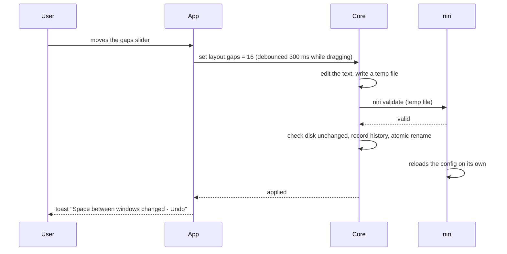
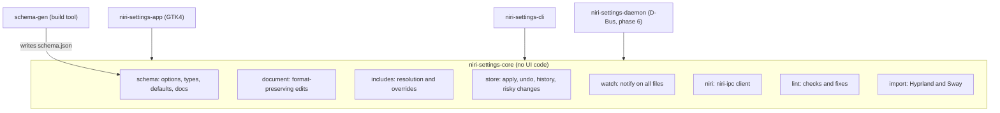

# niri settings: design draft

Draft 1 · 2026-11-13

**The goal:** the standard settings app for niri, the one anyone can install
and enjoy niri with, without ever learning KDL. Experts must trust it too: it
never breaks the config and never messes up a hand-written file.

This document is written for the people and coding agents who build the app.
Every section ends in decisions, not options. Items marked **Verify** are
facts to confirm before building on them.

---

## 1. Principles

1. **Changes apply at once, like any desktop settings app.** There is no Save
   button. Moving a slider changes the real desktop within half a second.
2. **Every change can be undone.** Control+Z, an Undo button on every change
   notice, and a full history of past versions.
3. **Risky changes ask for confirmation.** Displays, input devices and
   shortcuts that could lock the user out revert on their own after 15 seconds
   unless the user presses Keep.
4. **The file stays the user's.** Only changed values are rewritten. Comments,
   order and formatting survive. Reading and writing back with no changes
   gives the same bytes.
5. **Plain words first, config names second.** Labels say what an option
   does ("Space between windows"), not its config name (`layout.gaps`). The
   config name is shown as small secondary text for people who want to learn.
6. **Show, don't describe.** Visual options get a live picture of their
   effect.
7. **Every niri option is reachable.** Options without a designed page appear
   on the All options page, generated from niri's own config types.
8. **Usable by everyone.** Full keyboard use, screen readers, high contrast,
   large text and right-to-left layouts all work.

## 2. Users

Design for the newcomer first; do not get in the way of the expert.

| User | Typical first need | Main features for them |
| --- | --- | --- |
| Newcomer (primary) | "Make it look and feel right" | Welcome flow, presets, live changes, pictures of each option |
| Switching from Hyprland or Sway | "Bring my setup over" | Import, a familiar shortcut scheme |
| Dotfiles user | "Change one thing, keep my file clean" | Format-preserving edits, Careful mode with a diff (section 7.3) |
| Nix user | "Help me although my file is generated" | Copy as Nix (section 7.6) |
| Anyone with a problem | "Why does this happen?" | Check my setup, "Why?" on windows and shortcuts |

## 3. Technology decisions

| Area | Decision | Reason |
| --- | --- | --- |
| Language | Rust, edition 2024 | Same as niri; its crates can be used directly |
| UI toolkit | **GTK4 + libadwaita via `relm4`** | The standard look on Linux desktops, built-in screen-reader support (AT-SPI), right-to-left, high contrast and large text, and adaptive layouts that work on narrow windows |
| Talking to niri | `niri-ipc` crate, pinned to the niri version we target | Typed requests and events over niri's socket |
| Schema | Generated at build time from niri's `niri-config` crate (section 9) | Every option, its type and default, kept current by CI |
| KDL editing | `kdl` crate (kdl-rs 6.x, KDL v1) if it passes the same-bytes test; otherwise our own parser that records byte ranges and splices only changed values | Format-preserving edits |
| File watching | `notify` | Instant updates for the main file and every included file |
| Tests | `tempfile`, `proptest`, `insta` (snapshots) | Temporary configs, random edits, diff snapshots |

GTK4 is chosen because "anyone can enjoy it" needs native accessibility and
the familiar desktop look.

**Verify:** current versions of `relm4`, `libadwaita`, `niri-ipc`, `kdl` and
`notify`; that `niri-ipc` exposes window picking, output changes and the
action list.

## 4. How the app is organised

Pages are grouped by what people want to do, not by niri's config sections.
A top bar picks one of five sections; a row of buttons under it picks the
page in that section. Search opens below the top bar (Control+F).

| Section | Pages |
| --- | --- |
| Home | Home |
| Style | Appearance, Windows and layout, Animations |
| Input | Keyboard, Shortcuts, Mouse and touchpad |
| System | Displays, Workspaces, Apps, Startup |
| Advanced | Check my setup, All options, Config file |

| Page | Contents | niri config areas it covers |
| --- | --- | --- |
| Home | First-run flow (section 6.1), then the config path, setup problems and import | none |
| Appearance | Gaps, focus ring, borders, shadows, corner radius, window opacity, cursor theme and size, presets | `layout`, `cursor`, window rules for corners and opacity |
| Windows and layout | Default column width, preset widths, centring, struts, where new windows open, empty workspaces | `layout`, `workspace` behaviour |
| Apps | Window rules in plain words, pick a window (section 6.4) | `window-rule` |
| Keyboard | Layouts and variants, repeat rate and delay, Num Lock, Caps Lock behaviour | `input.keyboard` |
| Shortcuts | Visual keyboard, shortcut list, recording, schemes (section 6.5) | `binds` |
| Mouse and touchpad | Speed, acceleration, natural scrolling, tap to click, gestures, focus follows mouse | `input.mouse`, `input.touchpad`, `gestures` |
| Displays | Arrangement by drag or keyboard, resolution, refresh rate, scale, rotation, variable refresh rate (section 6.6) | `output` |
| Workspaces | Named workspaces and which display they open on | `workspace` |
| Animations | Presets, per-animation curve and speed with preview | `animations` |
| Startup | Apps that start with niri, environment variables | `spawn-at-startup`, `environment` |
| Check my setup | Problems found, with fixes that you apply with one click (section 6.7) | all |
| All options | Every option from the schema, grouped by config section | all |
| Config file | The whole file as text, with a live link to the controls (section 6.8) | all |

Pages that do not apply are hidden, not disabled. For example, Mouse and
touchpad shows only the touchpad group when no mouse has ever been seen.

## 5. Window layout

### 5.1 Main window

```
┌──────────────────────────────────────────────────────────────────────────┐
│   🔍  [⌂ Home] [◐ Style] [⌨ Input] [▭ System] [⚙ Advanced]  ☰   │
├──────────────────────────────────────────────────────────────────────────┤
│        ( Appearance ● | Windows and layout | Animations )                │
│ ┌──────────────────────────────────────────────────────────────────────┐ │
│ │   live picture: columns, gaps, focus ring                            │ │
│ └──────────────────────────────────────────────────────────────────────┘ │
│  Presets   [ Compact ] [ Balanced ] [ Roomy ]                            │
│                                                                          │
│  Space between windows                                          16 px   │
│  layout.gaps                                  [ 16  − + ] px   ?   │
│                                                                          │
│  Focus ring                                                      [ on ]  │
│  Window shadows                         Set by Noctalia      Override    │
│ ┌──────────────────────────────────────────────────────────────────────┐ │
│ │ Space between windows changed to 16 px                     [ Undo ]   │ │
│ └──────────────────────────────────────────────────────────────────────┘ │
└──────────────────────────────────────────────────────────────────────────┘
```

- The top bar is an `AdwViewSwitcher`. A section opens at the page last
  shown there.
- Search and the ☰ menu sit beside the tabs as one centered group, not in the
  window corners. niri tiles windows with gaps, so a corner is not a screen
  edge, and on a wide window it is far from the content (Fitts's law). Only
  the window controls stay at the edge.
- The page row is an `AdwToggleGroup`. It is hidden for Home, which has one
  page, and scrolls sideways when the window is too narrow.
- `?` on a changed row opens the help and offers Reset to the niri default.
  Other rows keep the help in the subtitle, so they do not need an icon.
- Search (button or Control+F) opens a bar under the top bar. Results show
  matching pages first, then options. Escape closes it and clears it.
- The bottom notice is a libadwaita toast. It stays 5 seconds. Several quick
  changes merge into one toast ("3 changes · Undo").
- When the centered group no longer fits with full tab labels, the sections
  move to an `AdwViewSwitcherBar` at the bottom, the top bar shows the page
  title, and search and the menu move to the corners. The app measures this
  width at start, because it depends on the language and text size (about
  950 px in English); it is never below 600 sp. Tab labels are never cut off.

### 5.2 Setting row

Every setting row has the same parts:

```
 Label in plain words                         control      ?
 config.name · one-line help                 (badge)
```

| Part | Rule |
| --- | --- |
| Label | Plain words, sentence case, no config jargon |
| Config name | Small, dimmed, monospace. Hidden when "Show config names" is off in Preferences (default: off) |
| Help | One line from the schema, rewritten in plain words (section 9.3). A `?` button opens the full niri wiki text and a link |
| Control | Chosen by type, using the libadwaita row for it: switch row, spin row with its unit, combo row, colour button (activating the row opens the picker), text field, key recorder. The whole row is the control where libadwaita allows it. Sliders are not used: they do not fit a 360 px window, and the live picture already shows the effect. |
| Badge | "Set by Noctalia" or another file name when an included file sets the value (section 7.4); "Needs niri 25.11" when the option is newer than the running niri |
| Reset | In the `?` dialog, when the value differs from niri's default |
| Unavailable | Greyed out when the section switch above it is off, with "Turn on Focus ring to use this." before the help. Nested sections count: everything under Animations greys out when animations are off. |

## 6. Main flows

### 6.1 Welcome (first run)

Shown on the first start, and from the Welcome page later. Every step can be
skipped. Nothing is written until the last step.

1. **Hello.** One sentence about niri, plus a 6-second looping picture of
   scrollable tiling (windows sliding sideways in a strip).
2. **Coming from somewhere?** Buttons: GNOME, KDE, Hyprland, Sway, macOS,
   Windows, "New to all this". Hyprland and Sway lead to Import (section
   6.9). The others set the shortcut scheme (section 6.5).
3. **Look.** The Appearance presets, previewed live as the user clicks them.
   Written on the last step.
4. **Feel.** The Animations presets, previewed live. Written on the last step.
5. **Keyboard.** Keyboard layout, detected from the system locale and written
   only if the user changes it.
6. **Done.** A summary of changes; Keep or Go back. Then a short card with
   the five most useful shortcuts.

### 6.2 Changing a setting



- If validation fails, the control goes back to the old value and an inline
  error under the row shows niri's message in plain words.
- If the file changed on disk meanwhile, the app reloads it, re-applies the
  change on top if it still applies cleanly, and otherwise shows the conflict
  dialog (section 7.2).
- **Verify:** niri reloads the config on its own when the file is replaced by
  a rename. If not, call the IPC reload action after each write.

### 6.3 Risky changes

These ask for confirmation after applying:

- Display resolution, refresh rate, scale, rotation, position, or turning a
  display off.
- Disabling the touchpad or mouse while it is the only pointer device.
- Changing or removing the shortcut that is the only way to open a terminal,
  the app launcher or this app.
- Changing the keyboard layout.

```
┌──────────────────────────────────────────────┐
│  Keep these display settings?                │
│                                              │
│  Reverting in 15 seconds.                    │
│                                              │
│            [ Revert ]   [ Keep changes ]     │
└──────────────────────────────────────────────┘
```

- Displays change through niri's live output commands first. The file is
  written only after Keep.
- The other risky changes write the file and revert it unless Keep is
  pressed.
- Escape, closing the dialog, or doing nothing means Revert.
- Before a risky change, the core writes a marker file
  (`$XDG_STATE_HOME/niri-settings/pending-revert`). If the app crashes or is
  killed, the next start finds the marker and reverts at once. A small
  `niri-settings-cli --recover` command does the same and can be bound to a key.

### 6.4 Apps (window rules)

The page lists apps with rules first, then open apps without rules.

```
 Apps                                              [ ⊕ Pick a window ]
 ───────────────────────────────────────────────────────────────────
 ▣ Firefox            Opens maximised · Rounded corners 12 px    ›
 ▣ pavucontrol        Floats · 600 × 400                          ›
 ───────── Open now, no rules ─────────
 ▢ Alacritty                                                    Add
 ▢ Spotify                                                      Add
```

- **Pick a window** asks niri to let the user click a window, then opens the
  rule editor for it. **Verify:** `niri-ipc` window picking.
- The rule editor reads as a sentence:

```
 When  [ Firefox ▾ ]  opens
   ☑ Float it                      ☐ Open fullscreen
   ☑ Size   [ 1200 ] × [ 800 ]     ☐ Open on workspace [ ▾ ]
   ☐ Open on display [ ▾ ]         ☑ Corner radius [ 12 ] px
   ☐ Opacity [ ──●── ] 90 %        ☐ Block from screen capture
 Match by  ● app   ○ app and title contains [            ]
 Matches 2 open windows.                       [ Delete rule ]
```

- "Matches N open windows" updates live from niri's window list.
- Matching uses exact app IDs by default (anchored and escaped regex). The
  title option is for people who need it; raw regex lives on All options.
- **Why?** Right-clicking an app, or the `why` command, explains which rules
  match a window and which rule takes effect.

### 6.5 Shortcuts

```
 Shortcuts          Scheme: [ niri default ▾ ]     🔍 Find a shortcut
 ┌─────────────────────────────────────────────────────────────────┐
 │ [Esc][F1]...                                                    │
 │ [`][1][2][3][4][5][6][7][8][9][0][-][=][⌫]                      │
 │ [⇥][Q][W][E][R][T][Y][U][I][O][P][[][]]                         │
 │ ...  keys with a shortcut are tinted; hover shows the action    │
 │ Modifiers: [Super ●] [Ctrl] [Alt] [Shift]                       │
 └─────────────────────────────────────────────────────────────────┘
 Windows        Super+Q   Close window                         ›
                Super+F   Maximise column                      ›
 Workspaces     Super+1   Go to workspace 1                    ›
 Apps           Super+T   Open terminal (alacritty)            ›
 System         Super+⇧+E Quit niri                            ›
                                                   [ + Add shortcut ]
```

- The keyboard shows the user's actual layout. Choosing modifiers above it
  shows what each key does with that combination. Free keys are blank, so
  finding a free combination takes one look.
- Actions are grouped and named in plain words ("Close window", not
  `close-window`). The list of actions comes from `niri-ipc`.
- **Recording:** press Record, press the combination. niri itself catches
  keys it has bound, so recording a taken combination does not reach the
  app. The recorder then says "Super+Q is already Close window" and offers
  to change that shortcut instead. **Verify** whether niri can briefly stop
  handling binds while recording; if it can, use it.
- **Conflicts** are checked against the user's shortcuts and niri's
  built-in ones.
- **Schemes:** niri default, GNOME-like, KDE-like, macOS-like, Vim-style.
  Choosing one shows a diff of the shortcuts it changes before applying.

### 6.6 Displays

- Drag the displays to arrange them; edges snap to each other. With the
  keyboard, Tab to the picture, press 1–9 to choose a display, move it with
  the arrow keys (Shift for one pixel), and press Enter to apply.
- Per display: resolution, refresh rate, scale (with a suggested value),
  rotation, variable refresh rate, on or off.
- Risky by definition (section 6.3).
- The display list follows plug and unplug events from niri live.
- When niri is not running, the page says so and shows displays saved in
  the file only.

### 6.7 Check my setup

Lints run on start, after every change, and when any watched file changes.

| Check | Example message | One-click fix |
| --- | --- | --- |
| Duplicate shortcut | "Super+T is bound twice. niri uses the second one." | Remove the first, or record a new key for it |
| Rule matches nothing | "The rule for `org.gnome.Nautilus` matches no app you have used." | Pick the right app |
| Deprecated option | "`prefer-no-csd` was renamed in niri 25.x." | Replace with the new name |
| Value overridden | "Noctalia sets the focus ring colour, so your value has no effect." | Override, or remove yours |
| Missing program | "niri starts `waybar` at startup, but the program is not installed." | Remove from startup |
| No way back | "No shortcut opens a terminal or launcher." | Add the default one |
| Invalid file | niri's own message, in plain words | Open Config file at that line |

**Verify** each example against current niri before using it as a test
fixture.

### 6.8 Config file

- A text editor (GtkSourceView) with KDL highlighting.
- Placing the cursor on a line shows the matching control in a side panel.
  Changing that control highlights the line it changes.
- Text edits apply after validation, either when the user presses Apply or
  after 1 second without typing. Invalid text shows niri's error inline and
  is not written.
- Included files open in tabs. Files that a shell manages (Noctalia, DMS)
  open read-only, with a note that the shell rewrites them.

### 6.9 Import from Hyprland or Sway

1. Detect `~/.config/hypr/hyprland.conf` or `~/.config/sway/config`, or let
   the user choose a file.
2. Translate shortcuts, gaps, borders, window rules, display setup, startup
   apps and environment variables.
3. Show a preview: what was translated (with the niri result), and what has
   no niri equivalent, in plain words.
4. Apply as one change, undone in one step.

The translators live in the core as pure functions with snapshot tests.

### 6.10 Presets

| Group | Presets |
| --- | --- |
| Appearance | Compact, Balanced, Roomy |
| Animations | Snappy, Smooth, Playful, Off |
| Shortcuts | The schemes in section 6.5 |

A preset changes several settings at once. It is one undo step. Presets are
data files in the repo (`presets/*.kdl` snippets), so the community can add
more.

## 7. Safety and the file

### 7.1 Writing

Every write follows these steps, in order.

1. Resolve the real target. If the config is a symlink, write through to the
   file it points at and keep the link. Refuse targets in `/nix/store` and
   read-only files (section 7.6).
2. Copy the config tree to a scratch folder in the system temp folder and
   apply the new text there. `niri validate` runs on that copy with the
   include paths rewritten to a second mirror, so includes in other folders
   resolve and no outside file is touched. On failure, return niri's message
   with terminal colour codes stripped and write nothing.
3. Read every target again. If any file differs from the text we loaded, stop
   with a conflict (section 7.2). This is a check immediately before writing,
   not a lock: another program can still change a file between the check and
   the rename.
4. Record the old text of every changed file in history (section 7.5). If the
   record cannot be saved, nothing is written.
5. Write the recovery journal in the state folder: every file's before and
   after text, and the history entry. `fsync` it. Nothing is renamed until
   the journal is on disk.
6. Write the files one at a time in dependency order: override files first,
   then included files, then the file that includes them; deletions last.
   Each file is a temp file in its folder, `fsync`, permissions copied, then
   a rename over the target — atomic per file.
7. Mark the journal committed, then remove it. A committed journal is
   rolled forward on the next open; an uncommitted one is rolled back.
8. If a write fails, put back the files already written from their recorded
   old text, newest first, and discard the history entry when the rollback
   succeeded. If the rollback itself fails, leave the journal in place so
   the next open retries the restore.
9. On open, replay any journal. An uncommitted change is rolled back, a
   committed one is finished. A file that matches neither side was changed
   by another program while the journal waited; leave it as found and report
   it. Then remove the journal.

The interrupt window is now the moment before the journal reaches disk (no
file has changed yet) and the moment after the last rename but before the
committed marker (the change is rolled back on the next open). An external
edit to a journal file is reported, not overwritten.

### 7.2 Other programs

- `notify` watches the folders that hold the main file and every included
  file. When the set of files changes (a new include appears or an include is
  removed), the app rebuilds the watcher. Any change in those folders causes
  a reload; the app compares the text and ignores unrelated events.
- With no change in flight, a change on disk reloads silently and the page
  updates.
- If a change made by the app and a change on disk touch the same value, a
  dialog shows both values and asks which to keep.

### 7.3 Careful mode

Dotfiles users who want to see every change get a staged review mode:
changes are staged, a bar shows "4 changes · Review · Discard", and Review
shows a diff of the file before writing. This is not built in 0.1.0, so the
app does not offer an "Ask before saving changes" preference. Until it is
built, every change applies at once and can be undone (section 15.2).

### 7.4 Included files

- The core resolves includes in the order and position niri uses.
  **Verify** the exact rule (in place at the `include` line, or merged after
  the main file) against the niri version we target, and test both
  orderings.
- A value that comes from an included file shows the badge "Set by <file>"
  and an **Override** button. Override inserts the user's value after that
  `include` line in the main file, so niri uses the user's value from then on.
- Shell names: Noctalia, DMS, Stylix and matugen are recognised by path and
  shown by name.

### 7.5 History

- Every applied change makes a history entry: time, a one-line summary
  ("Gaps 8 → 16 px"), and the full file before and after.
- Stored in `$XDG_STATE_HOME/niri-settings/history/`, keeping the last 200
  entries.
- Preferences → History lists them; any entry can be restored, and that is a
  change too, so it can be undone.

### 7.6 Read-only and Nix

- When the config links into `/nix/store`, a banner explains that Nix
  generates the file.
- Controls still work, but in staging mode: each change adds to a "Copy as
  Nix" panel that shows the matching niri-flake `programs.niri.settings`
  snippet. **Verify** niri-flake's current option names.
- Other read-only files: banner, controls disabled, a button to open the
  file's folder.

## 8. Architecture



### 8.1 Workspace layout

```
crates/
  core/          niri-settings-core: everything that touches files or niri
  cli/           niri-settings-cli (also built into the app binary)
  app/           GTK4 + libadwaita app (relm4)
  schema-gen/    reads niri-config, writes core/schema/schema.json
data/
  pages/*.toml   which options appear on which designed page, with labels
  presets/*.kdl  preset snippets
  help/*.toml    plain-words help, keyed by option path
tests/
  configs/       real-world configs: default, Noctalia, DMS, dotfiles, broken
```

### 8.2 Core API (sketch)

```rust
pub struct Session { /* loaded config, includes, schema, history */ }

impl Session {
    pub fn open(path: &Path) -> Result<Session, OpenError>;
    pub fn options(&self) -> &[OptionInfo];                 // from the schema
    pub fn get(&self, path: &OptionPath) -> Resolved;       // value + where it comes from
    pub fn set(&mut self, path: &OptionPath, v: Value) -> Result<Applied, ApplyError>;
    pub fn apply_snippet(&mut self, kdl: &str) -> Result<Applied, ApplyError>; // presets, import
    pub fn begin_risky(&mut self, change: Change) -> Result<RiskyGuard, ApplyError>;
    pub fn undo(&mut self) -> Result<Applied, ApplyError>;
    pub fn history(&self) -> &[HistoryEntry];
    pub fn lint(&self) -> Vec<Problem>;
    pub fn why_window(&self, w: &WindowInfo) -> RuleExplanation;
    pub fn subscribe(&self) -> Receiver<Event>;             // file and niri events
}

pub struct Resolved { pub value: Value, pub source: Source }   // Default | MainFile | Include(name)
pub struct RiskyGuard { /* Drop = revert unless keep() was called */ }
```

Rules for the core:

- No GTK or any UI type in `core`. The app and CLI only call `Session`.
- No direct `std::process::Command` outside `core::niri`.
- Every public function has unit tests. File-touching tests use `tempfile`
  and never the user's real config.

### 8.3 Command line

```
niri-settings-app                 open the app
niri-settings-cli get <option>    print a value and where it comes from
niri-settings-cli set <option> <value>  apply a change (validated, undoable)
niri-settings-cli undo            undo the last change
niri-settings-cli history         list changes
niri-settings-cli check           run Check my setup; exit 1 on problems
niri-settings-cli why window      pick a window, explain its rules
niri-settings-cli import <file>   import Hyprland or Sway, with --dry-run
niri-settings-cli --recover       revert an unconfirmed risky change
niri-settings-cli --page <page>   open the app on a page
```

All commands take `--json` for scripts and `--config <path>`.

### 8.4 D-Bus service (phase 6)

`io.github.niri_settings.NiriSettings1` exposes `Get`, `Set`, `Undo`, `ListOptions` and a
`Changed` signal, backed by the same `Session`. Shells such as Noctalia and
DMS can build their own panels on it. Design the core so this needs no
changes to it: all state lives in `Session`, and all events go through
`subscribe`.

## 9. Schema

### 9.1 Generation

`schema-gen` reads niri's `niri-config` crate at the targeted niri version
and writes `schema.json`: for every option, its path, kind, allowed values or
range, default, the niri version that added it, and its doc comment.
**Verify** the extraction method; prototype it first (phase 1). If it proves
unreliable, propose a `niri config schema` command to niri upstream and keep a
hand-checked `schema.json` meanwhile.

### 9.2 CI

A scheduled job runs `schema-gen` against niri's latest release and opens a
pull request when `schema.json` changes. Tests fail if a designed page in
`data/pages/*.toml` names an option that no longer exists.

### 9.3 Labels and help

`schema.json` is generated; human words are not. `data/help/*.toml` holds the
plain-words label and one-line help per option path. Options without an entry
fall back to a label made from the config name and niri's doc comment. A test
lists options that have no human words yet, so coverage can grow over time.

## 10. Words

- Plain English, sentence case, short sentences. Say what happens: "Windows
  float above others", not "Enable floating".
- Never say "KDL", "node" or "property" outside the Config file page.
- Errors say what happened, why, and what to do: "niri didn't accept this
  value. Width must be between 0 and 65535. Your file is unchanged."
- Units are shown on every number (px, %, ms, Hz).
- All strings go through `gettext` from day one, so translation works later.

## 11. Accessibility

- Every control has an accessible name (its label) and description (its
  help). Icon-only buttons have names.
- Everything works by keyboard: Tab order follows reading order; Control+F
  focuses search; Control+, opens preferences; Control+Z undoes; Escape
  closes dialogs and reverts risky changes. The display picture also takes
  number keys to select a display, arrow keys to move it, and Enter to apply.
- Live pictures (gaps, animations) have a text alternative that states the
  values, and respect "Reduce motion".
- Colour is never the only signal (problems carry an icon and text).
- Test with Orca on every page before each release.

## 12. Milestones

Each milestone ends with its acceptance checks passing in CI.

| # | Milestone | Acceptance checks |
| --- | --- | --- |
| 1 | Prove the bets: schema extraction prototype; KDL same-bytes test on `tests/configs`; include ordering confirmed | `schema.json` covers every option in the targeted niri; every test config round-trips to the same bytes |
| 2 | Core: `Session` with open, get, set, undo, history, watch, includes; save path (section 7.1) | Property test: random edits on test configs always validate or are refused without writing |
| 3 | CLI and lint: section 8.3 commands, Check my setup | Every option can be read and set from the CLI; each lint has a fixture test |
| 4 | App, part 1: window shell, setting row, All options, Appearance, Windows and layout, Keyboard, Mouse and touchpad, Animations, Startup | Every page usable by keyboard and with Orca; Undo works for every control |
| 5 | App, part 2: Apps, Shortcuts, Displays, Workspaces, Config file, Welcome, presets, import, risky changes | Risky-change revert survives killing the app (marker test); import snapshot tests pass |
| 6 | Release: name, packaging (nixpkgs, Home Manager module, AUR), D-Bus service | Installs and runs on NixOS, Arch and Fedora; D-Bus `Set` round-trip test |

## 13. Rules for agents building this

1. Read this file first. If something here is wrong or unclear, raise it
   instead of guessing.
2. One milestone at a time, in order. Small pull requests, one feature each.
3. No change without tests. Core logic needs unit tests; flows need
   integration tests with temp configs.
4. Never touch the real `~/.config/niri/config.kdl` in tests or scripts. Use
   `tempfile` and `--config`.
5. Every **Verify** item touched by a task must be confirmed against the
   current niri source or documentation, and the result noted in the pull
   request.
6. Keep the core free of UI code (section 8.2).
7. Run `cargo fmt`, `cargo clippy --all-targets -- -D warnings` and
   `cargo test --workspace` before each pull request.

## 14. Open questions

- [ ] The new name.
- [ ] Is a 15-second revert window right for every risky change, or should
      displays use 15 s and the rest 10 s?
- [x] "Show config names" defaults to off: calmer for newcomers. One switch
      in Preferences shows the names for people learning the file.
- [ ] Which shells to approach first about the D-Bus service: Noctalia, DMS,
      or both?

---

## 15. Implementation status (2026-11-13)

This section records what the code does now. It does not replace the design
above.

### 15.1 What works

| Area | Status |
| --- | --- |
| Schema drift | `scripts/check-schema.sh` regenerates from the niri source in the dev shell and fails on a diff. It also pins the source version in `data/schema.version`, so a niri bump needs a reviewed schema diff. CI runs it. |
| Validation | The app, CLI and D-Bus service refuse to open a session when niri is not on `PATH`, so no write is made without `niri validate`. |
| Safe writes | Scratch copy, `niri validate`, disk check, history recorded before writing, recovery journal, ordered per-file renames, rollback; pending journal rolled back on open, committed journal finished |
| Includes | In-place merge order, nested includes, optional includes |
| Managed files | Noctalia, DMS, Stylix and Nix values go to an override file |
| Undo and history | One undo step per change, redo, restore from history |
| CLI | `get`, `set`, `reset`, `undo`, `redo`, `history`, `check`, `import`, `why`, `options`, `validate` |
| App shell | Top bar with sections and a page row, search bar, toasts, undo, preferences, history dialog |
| Welcome | First-run flow with Hello, Source, Look, Feel, Keyboard and Done. Choices are staged and written once at the end. |
| Pages | Home, Appearance, Layout, Keyboard, Mouse, Animations, Startup, All options, Config file, Check my setup, Shortcuts, Apps, Workspaces, Displays |
| Visual previews | Columns, gaps, focus ring, border, shadow, animation motion |
| Presets | Compact, Balanced, Roomy, Off, Snappy, Smooth, Playful |
| Shortcut schemes | GNOME-like, macOS-like, Vim-style |
| Import | Hyprland and Sway shortcuts, gaps, border, input, startup |
| Checks | Duplicate binds, missing startup program, missing include, managed override, unused rule, missing terminal, invalid file |
| Displays | Drag arrangement with edge snap, or keyboard: number keys select, arrows move, Enter applies. Mode, scale, rotation, position and VRR. A change reverts after 15 seconds unless you press Keep. |
| Repair mode | A small editor opens for a broken config and saves only after `niri validate` passes |
| Schema | `schema-gen` reads niri-config and writes 194 options to `data/schema.json`. The 68 designed options have controls. The rest open in the config file. |
| Config location | Found exactly as niri 26.04 finds it, including `$NIRI_CONFIG` (ignored when empty) and the `/etc/niri/config.kdl` fallback. The system file opens read-only with a banner and "Make a personal copy", which rewrites relative includes to absolute paths. With no config, the app says so instead of opening an editor. |
| Includes outside the folder | The validation mirror rewrites include paths. Absolute includes are editable. |
| D-Bus | `niri-settings-daemon` serves `io.github.niri_settings.NiriSettings1` with `Get`, `Set`, `Undo`, `Redo`, `ListOptions` and a `Changed` signal. |
| Translations | Page titles and common controls have German, French and Turkish tables. Option help falls back to English. |
| Accessibility audit | `NIRI_SETTINGS_A11Y=1` checks control names. `docs/accessibility.md` has the Orca procedure. |

### 15.2 What is not done

| Area | Current limit |
| --- | --- |
| Schema values | The generated schema has paths and kinds. It does not extract defaults or every custom KDL shape. |
| Careful mode | The staged diff review is not built. Changes apply at once and can be undone, so there is no "ask before saving" preference. |
| Interrupted writes | A journal restores or finishes a change on the next open. If another program edits one of the journal files before then, that file is left untouched and reported. |
| Welcome card | The five shortcuts are shown but cannot be printed or saved as a PNG. Hyprland and Sway full import stays on Home. |
| Shortcut recording | Taken keys are reported by the Shortcuts page. The recorder does not stop niri from handling the key. |
| Nix flake options | The app copies a `programs.niri.settings` block. It does not read niri-flake option names. |
| Translations | Most option labels and help text are not translated yet. |
| Orca test | The automated control-name audit passes. A person must still run the Orca procedure on a desktop. |

### 15.3 Verified items

These items had a **Verify** mark in the draft. Each was checked against niri
26.04 source or its wiki.

- Include order: an include merges at its own line. Later values win.
  Includes nest up to 10 levels. `optional=true` works.
- `niri-ipc` 26.4 exposes outputs, windows, workspaces, window picking and
  output changes. The app uses `niri msg --json` for the same data.
- `niri validate -c PATH` works on a scratch file.
- A rename over the config does not always keep the old watch. The app calls
  `niri msg action load-config-file` after a risky display change. Normal
  writes rely on niri's own watcher.
- A bare `prefer-no-csd` is valid. A nested flag with `false`
  (`input.touchpad.natural-scroll false`) is not valid.
- `layout { border {} }` enables the border in the main file only.
